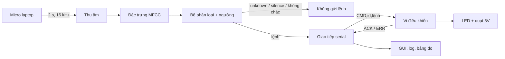

# Báo cáo: Điều khiển thiết bị điện áp thấp bằng giọng nói tiếng Việt chạy offline

> Bản nháp. Các chỗ `[cần điền: ...]` sẽ bổ sung khi có kết quả thật, kèm theo lệnh hoặc notebook dùng để lấy số liệu. Không điền số từ dữ liệu tổng hợp hay dữ liệu thử.

**Nhóm:** Phan Tiến Đạt (CNTT), [họ tên] (Điện tử Viễn thông)
**Học phần / GVHD:** [cần điền]
**Mã nguồn:** github.com/OwenDepTry/vietnamese-offline-voice-control, commit [cần điền: `git rev-parse --short HEAD`]

---

## Tóm tắt

[cần điền, viết sau cùng, khoảng 150-200 từ: bài toán, cách làm, dữ liệu, kết quả chính (macro-F1 trên test, tỉ lệ kích hoạt nhầm, độ trễ median/p95, tỉ lệ thiết bị chạy đúng), hạn chế lớn nhất.]

## 1. Giới thiệu

Phần lớn các hệ thống điều khiển bằng giọng nói hiện nay cần Internet và gửi giọng nói lên máy chủ để xử lý. Nhóm muốn thử làm một hệ thống nhỏ chạy hoàn toàn trên máy tính cá nhân, nhận lệnh tiếng Việt và điều khiển đèn, quạt 5V thông qua vi điều khiển.

Mục tiêu của bản MVP là nhận đúng 4 lệnh "bật đèn", "tắt đèn", "bật quạt", "tắt quạt", bỏ qua các câu nói khác và lúc im lặng, rồi gửi lệnh qua cổng serial tới vi điều khiển và nhận lại xác nhận.

Phạm vi: người dùng bấm nút rồi nói (mỗi lần 2 giây), chưa làm nghe liên tục hay từ đánh thức. Model chạy trên laptop, chưa đưa xuống vi điều khiển. Tải chỉ dùng điện áp thấp.

Đề tài kết hợp hai mảng: CNTT lo phần thu dữ liệu, học máy và phần mềm; Điện tử Viễn thông lo mạch lái tải, firmware và giao tiếp UART. Phân công cụ thể ở mục 9.

## 2. Kiến trúc hệ thống



Toàn bộ phần nhận dạng chạy trên máy. Nhóm kiểm tra điều này bằng một test chặn mọi kết nối mạng trong lúc chạy cả chuỗi xử lý, và bằng demo khi tắt Wi-Fi (mục 6.4).

Phần mềm viết bằng Python 3.12 với NumPy, SciPy, scikit-learn, Tkinter và pySerial (phiên bản ghi trong `requirements.txt`).

Phần cứng: [cần điền (ĐTVT): board, mạch lái, nguồn, lấy từ `hardware/BOM.csv` và `hardware/wiring.md`, kèm ảnh mạch.]

## 3. Dữ liệu

### 3.1 Các nhãn

| Nhãn | Câu nói | Loại |
|---|---|---|
| LIGHT_ON | bật đèn | lệnh |
| LIGHT_OFF | tắt đèn | lệnh |
| FAN_ON | bật quạt | lệnh |
| FAN_OFF | tắt quạt | lệnh |
| unknown | câu ngắn bất kỳ (có cả câu chứa chữ "đèn", "quạt" nhưng không phải lệnh) | không phải lệnh |
| silence | tiếng nền, không nói | không phải lệnh |

### 3.2 Cách thu

Mỗi bản thu là file WAV 2 giây, 16 kHz, mono, 16 bit. Micro: [cần điền]. Phòng: [cần điền]. Khoảng cách mặc định 1 m.

Người tham gia ký giấy đồng ý trước khi thu (mẫu ở phụ lục B). Dữ liệu chỉ gắn mã ẩn danh và không đưa lên repo. Sau mỗi lần thu, chương trình tự kiểm tra xem có bị nói nhỏ, bị cắt chữ hay bị rè không, và cho phép thu lại ngay.

| Người | Phiên | Số mẫu mỗi nhãn | Tổng | Điều kiện |
|---|---|---|---|---|
| p01 | s01 | 15 | 90 | yên tĩnh, 1 m |
| [cần điền] | | | | |

### 3.3 Vấn đề phát hiện trong dữ liệu

Khi chạy kiểm tra tự động trên 90 mẫu đầu tiên của p01/s01, có 5 file bị gắn cờ: 1 file nói quá nhỏ và 4 file có tiếng nói kéo tới tận cuối file. [cần điền: giữ, bỏ hay thu lại.]

Khi xem phổ tần, nhóm thấy đầu mỗi bản thu có khoảng 0,10-0,18 s tín hiệu bằng 0 (micro mở chậm), và trong các bản silence, tiếng nền giảm khoảng 14 dB sau giây 1,3, nhiều khả năng do chế độ lọc ồn của Windows. [cần điền: cách xử lý và ảnh hưởng tới kết quả.] Hình dạng sóng, phổ tần và thời điểm bắt đầu nói lấy từ notebook 01.

## 4. Phương pháp

### 4.1 Trích đặc trưng

Tín hiệu được nhấn tần cao (hệ số 0,97), chia frame 25 ms với bước 10 ms, FFT 512 điểm, qua 40 bộ lọc mel rồi lấy 13 hệ số MFCC. Clip được chia thành 4 đoạn thời gian, mỗi đoạn lấy trung bình và độ lệch chuẩn, ra vector 104 chiều.

Lý do chia 4 đoạn là để giữ thứ tự thời gian: "bật" và "tắt" khác nhau ở đầu câu, còn "đèn" và "quạt" khác nhau ở cuối câu. Nhóm cũng thử thêm tùy chọn dời đoạn có tiếng nói vào giữa clip trước khi tính MFCC.

### 4.2 Bộ phân loại và cơ chế từ chối

Nhóm thử ba bộ phân loại: hồi quy logistic (có cân bằng lớp), SVM nhân RBF (xác suất qua hiệu chỉnh sigmoid) và mạng nơ-ron một lớp ẩn 64 nút. Dữ liệu được chuẩn hóa bằng StandardScaler fit trên tập train.

Có thể tăng cường dữ liệu cho tập train: dịch thời gian trong khoảng ±0,25 s, đổi âm lượng ±6 dB, trộn tiếng nền lấy từ các bản silence với SNR 10-30 dB.

Nếu model đoán ra một lệnh nhưng score thấp hơn ngưỡng thì xem như unknown và không gửi lệnh. Ngưỡng được chọn sao cho macro-F1 trên tập validation cao nhất (thử từ 0 tới 1, bước 0,025). Nếu hòa thì chọn ngưỡng cao hơn cho an toàn.

### 4.3 Chia tập và tránh rò rỉ dữ liệu

Dữ liệu được chia theo phiên thu, một phiên không bao giờ nằm ở hai tập. Khi có đủ người thì chia theo người nói.

[cần điền, chọn một:] Với một người nói: train là p01/s01, validation là p01/s02, test là p01/s03, nên kết quả chỉ cho biết model nhận được giọng quen ở phiên mới. Với hai người: toàn bộ p02 làm test, nên kết quả là trên người mới.

Chương trình tự kiểm tra trùng đường dẫn, trùng nội dung file giữa các tập, và đảm bảo người/phiên trong test không có trong train hay validation. Mọi lựa chọn (bộ phân loại, tùy chọn đặc trưng, ngưỡng) chỉ dựa trên validation. Tập test chỉ chấm một lần sau khi đã chốt.

### 4.4 Giao thức serial

[cần điền: ghi v1.0 sau khi hai bên duyệt.] Cấu hình 115200 baud, 8N1, ASCII, mỗi dòng kết thúc bằng LF và dài tối đa 64 byte. Khi sẵn sàng, board gửi `READY,1`. Máy tính gửi `CMD,<id>,<lệnh>`, board trả `ACK,<id>,<lệnh>` hoặc `ERR,<id>,<mã lỗi>`. Mỗi lúc chỉ có một lệnh đang chờ, hết 1 giây không có trả lời thì báo lỗi và không tự gửi lại. Lệnh là đặt trạng thái (bật hoặc tắt) chứ không phải đảo trạng thái. Gặp lỗi bất kỳ thì app dừng gửi cho tới khi kết nối lại. ACK chỉ xác nhận firmware đã đặt chân ra, không chứng minh quạt đã quay.

### 4.5 Phần cứng và firmware

[cần điền (ĐTVT): sơ đồ khối, sơ đồ nối dây, tính dòng và áp, mạch lái quạt và diode bảo vệ, trạng thái chân lúc khởi động, cấu trúc firmware, kết quả `python -m app.conformance`.]

## 5. Thiết lập thí nghiệm

Máy tính: [cần điền: CPU, RAM, Windows], Python 3.12, phiên bản thư viện lưu trong file `.training.json` của model.

Các cấu hình được so sánh bằng `python -m ml.compare` (bảng ở notebook 02). Cấu hình chọn: [cần điền].

Các chỉ số: accuracy, macro-F1, F1 từng nhãn, confusion matrix; tỉ lệ kích hoạt nhầm (câu không phải lệnh bị nhận thành lệnh); tỉ lệ bỏ sót lệnh; độ trễ median và p95 từ lúc thu xong tới lúc có kết quả hoặc ACK; tỉ lệ thiết bị chạy đúng khi quan sát trực tiếp.

## 6. Kết quả

### 6.1 So sánh cấu hình trên validation

[cần điền: bảng và hình từ notebook 02. Ghi số mẫu validation, lưu ý chênh lệch nhỏ có thể do ngẫu nhiên.]

### 6.2 Kết quả trên tập test

[cần điền: từ `results/<thư mục>/summary.md`, `confusion_matrix.png`, `per_class_f1.png`, tạo bằng `python -m ml.report`.]

| Chỉ số | Giá trị |
|---|---|
| Loại đánh giá | [cùng người phiên mới / người mới] |
| Số mẫu test | |
| Accuracy | |
| Macro-F1 | |
| Kích hoạt nhầm | |
| Bỏ sót lệnh | |

### 6.3 Ảnh hưởng của lượng dữ liệu

[cần điền: learning curve từ notebook 02. Nhận xét đường còn đi lên hay đã đi ngang.]

### 6.4 Thử trực tiếp

[cần điền: bảng từ `python -m ml.trial_report` theo từng điều kiện: số lượt, đúng, bỏ sót, sai lệnh, kích hoạt nhầm, thiết bị chạy đúng, độ trễ median/p95. Ghi rõ lượt nào dùng firmware ảo, lượt nào dùng board thật, lượt nào tắt mạng.]

### 6.5 Phân tích lỗi

[cần điền: từ notebook 03. Cặp nhãn hay bị nhầm, các mẫu sai có score cao hay thấp, nghe lại để tìm nguyên nhân (nói nhỏ, bị cắt, ồn).]

## 7. Thảo luận và hạn chế

[cần điền, sửa lại theo kết quả thật. Những hạn chế nhóm đã thấy trước:]

- Số người nói còn ít, nếu chỉ đánh giá trên giọng đã có trong train thì chưa nói được gì về khả năng nhận người lạ. Muốn kết luận thì cần nhiều người hơn (khoảng 10 người trở lên).
- Tập test nhỏ nên chỉ một mẫu sai cũng làm kết quả thay đổi vài phần trăm. Vì vậy cần ghi số mẫu bên cạnh tỉ lệ.
- Mới dùng một micro và một môi trường. Micro khác, phòng ồn hay đứng xa có thể làm kết quả kém đi, cộng thêm vấn đề lọc ồn và đoạn im lặng đầu file ở mục 3.3.
- Score của model không phải xác suất thật, và ngưỡng được chọn trên tập validation nhỏ nên có thể chưa tối ưu.
- ACK chưa đảm bảo thiết bị đã chạy, cần quan sát hoặc thêm cảm biến.
- Mới làm kiểu bấm rồi nói, chưa đánh giá chế độ nghe liên tục.

## 8. Kết luận và hướng phát triển

[cần điền, một đoạn: so với mục tiêu MVP thì đạt được những gì.] Hướng phát triển: thu thêm người nói; thử CNN nhỏ (PyTorch) trên cùng tập dữ liệu để so với baseline; nghe liên tục với phát hiện tiếng nói và từ đánh thức; đưa model xuống vi điều khiển (STM32F411 với micro I2S); thêm cảm biến dòng để biết quạt có quay thật không.

## 9. Phân công

| Thành viên | Phần việc chính | Có thể kiểm tra ở |
|---|---|---|
| Phan Tiến Đạt (CNTT) | Thu dữ liệu, đặc trưng, train và đánh giá, GUI/CLI, giao thức phía máy tính, firmware ảo, notebook | lịch sử commit, `docs/TASKS.md` mục IT |
| [họ tên] (ĐTVT) | [cần điền: linh kiện, mạch, firmware, đo kiểm] | `hardware/`, `firmware/`, mục EE |
| Cả hai | Giao thức, ghép nối, đánh giá, video | mục BOTH |

## 10. Cách chạy lại kết quả

```powershell
py -3.12 -m venv .venv
.\.venv\Scripts\python.exe -m pip install -r requirements-notebook.txt
.\.venv\Scripts\python.exe -m unittest discover -s tests -v
# Dữ liệu không có trong repo, cần data/manifest.csv và data/raw/
.\.venv\Scripts\python.exe -m ml.prepare_data --manifest data/manifest.csv --output data/manifest_split.csv --validation [...] --test [...]
.\.venv\Scripts\python.exe -m ml.train_baseline --manifest data/manifest_split.csv --output models/[...].joblib [tùy chọn]
.\.venv\Scripts\python.exe -m ml.evaluate --manifest data/manifest_split.csv --model models/[...].joblib --output results/[...]
.\.venv\Scripts\python.exe -m ml.report --eval results/[...]
```

## Phụ lục

- A. Giao thức serial: `docs/PROTOCOL.md`, bảng hành vi trong notebook 04
- B. Mẫu giấy đồng ý thu âm: `docs/CONSENT_FORM.md`
- C. Kế hoạch kiểm thử và cách đo: `docs/TEST_PLAN.md`, `docs/MEASUREMENTS.md`
- D. Video demo chạy offline: [cần điền link]
